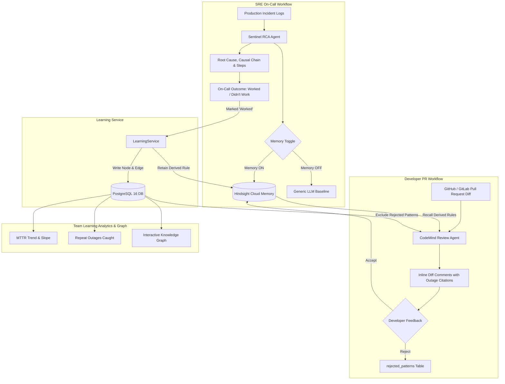

# Nexus AI — Cross-Agent Incident Learning System

> **Built for the "AI Agents That Learn Using Hindsight" Hackathon**  
> *Every production incident your team resolves makes future incident triage and pull request code reviews permanently smarter.*

---

## 1. System Architecture



---

## 2. The Four Pillars

1. **GitHub & GitLab Integration (Pillar 1):**  
   Automatically audits pull request diffs, maps repository paths to services (`service_map.yaml`), checks HMAC signatures on raw request bytes, and posts inline review comments citing past outages. Supports dry-run simulation mode without requiring live GitHub App credentials.
2. **AI Root Cause Analysis (Pillar 2):**  
   Sentinel moves beyond surface symptoms (e.g. timeouts, 500s) to identify the true underlying cause (e.g. unclosed DB connection in exception block, pool starvation, unbounded query), providing an ordered causal chain and actionable verify/fix steps.
3. **Interactive Knowledge Graph (Pillar 3):**  
   React Flow graph connecting services, incidents, root-cause categories, derived rules, PRs, and review comments. Clicking any node inspects its Hindsight memory text and relationship edges.
4. **Team Learning Analytics (Pillar 4):**  
   Measures real engineering improvement from Postgres: MTTR reduction slope, repeat incident rates, rule catch rates, memory ON vs OFF confidence comparison, and estimated hours saved.

---

## 3. Strict Division of Labor

- **Hindsight Cloud = Learned Knowledge:**  
  Semantic text memories searched by meaning. Retains resolved incidents, failed fix attempts, cross-agent review rules, and developer feedback with structured tags (`agent`, `type`, `service`, `source:incident-<id>`, `derived:true`).
- **PostgreSQL = System of Record:**  
  Authoritative storage for incident rows, step positions, diff comments, rejection fingerprints, daily metrics, and graph topologies. Postgres rows reference Hindsight only by memory ID.

---

## 4. Quick Start & Setup

### Option A: Docker Compose (Recommended)

1. **Clone the repository and copy the environment template:**
   ```bash
   cp .env.example .env
   ```
2. **Set your Groq API key in `.env`:**
   ```env
   GROQ_API_KEY=gsk_your_groq_api_key_here
   HINDSIGHT_API_KEY=your_hindsight_api_key_here
   ```
3. **Launch the stack:**
   ```bash
   docker-compose up --build
   ```
4. **Access the web app:**
   - Frontend: [http://localhost:3000](http://localhost:3000)
   - Backend API & OpenAPI Docs: [http://localhost:8000/docs](http://localhost:8000/docs)
   - Health Check: [http://localhost:8000/api/health](http://localhost:8000/api/health)

---

### Option B: Local Development

#### Backend Setup
```bash
python3 -m venv .venv
source .venv/bin/activate
pip install -r backend/requirements.txt

# Run migrations
cd backend
alembic upgrade head

# Start FastAPI server
uvicorn app.main:app --reload --port 8000
```

#### Frontend Setup
```bash
cd frontend
npm install
npm run dev
```

---

## 5. Automated Test Suite

Run all 34 automated unit and end-to-end acceptance tests:
```bash
source .venv/bin/activate
cd backend
pytest -v
```

---

## 6. Demo Script: 60-Second Walkthrough

### Step 1: Run Sentinel with Memory OFF
1. Navigate to **Sentinel (RCA)** in the web UI.
2. Click **Preset: Incident #12 (HikariPool Outage)**.
3. Toggle Hindsight Memory to **OFF**.
4. Click **Run Sentinel RCA Diagnosis**: Sentinel provides a generic guess with **low confidence (~45%)**.

### Step 2: Run Sentinel with Memory ON
1. Toggle Hindsight Memory to **ON**.
2. Click **Run Sentinel RCA Diagnosis**: Sentinel immediately recalls **Incident #12**, identifies the unreleased connection leak, displays an ordered causal chain, and achieves **high confidence (96%)**.

### Step 3: Trigger Cross-Agent Learning
1. Click **Worked (Trigger Cross-Agent Learning)**.
2. Sentinel records a 15-minute resolution time, saves the outcome into Hindsight, and **LearningService** derives a new review rule for CodeMind.
3. In **Dashboard**, the MTTR drops and the live learning feed updates with `Rule created for CodeMind`.

### Step 4: CodeMind PR Review
1. Navigate to **CodeMind (Review)**.
2. Review the payment webhook diff: CodeMind flags the unreleased connection on line 86, explicitly citing `Review rule from Incident #12`.

### Step 5: Reject a Noisy Pattern
1. Click **Reject (Exclude Pattern)** on a review comment.
2. The pattern is stored in `rejected_patterns`. Rerunning the review confirms the comment is deterministically excluded.

---

## 7. Webhook Testing & Simulation (Dry-Run Mode)

To simulate GitHub pull request webhook deliveries locally with HMAC signature verification:

```bash
# 1. Compute HMAC-SHA256 signature
SECRET="test-github-secret"
PAYLOAD='{"action":"opened","pull_request":{"number":201,"title":"Fix webhook connection","user":{"login":"alex"}},"repository":{"full_name":"nexus-org/payments-service"}}'
SIG="sha256=$(echo -n "$PAYLOAD" | openssl dgst -sha256 -hmac "$SECRET" | sed 's/^.* //')"

# 2. Send webhook to Nexus API
curl -X POST http://localhost:8000/api/integrations/github/webhook \
  -H "Content-Type: application/json" \
  -H "X-GitHub-Event: pull_request" \
  -H "X-GitHub-Delivery: test-delivery-001" \
  -H "X-Hub-Signature-256: $SIG" \
  -d "$PAYLOAD"
```

---

## 8. Scaling Path: Future Production Architecture

Nexus AI uses a PostgreSQL-backed jobs table with `SELECT ... FOR UPDATE SKIP LOCKED` for reliable, transactionally consistent job claiming without extra infrastructure overhead.

**Future scaling roadmap for enterprise deployments:**
- **Kafka / Redpanda:** Decouple high-volume GitHub webhook ingestion (`10,000+ events/sec`) from review worker execution.
- **Redis / Dragonfly:** Distributed cache for frequently accessed graph queries and transient rate limit counters.
- **Worker Pools:** Scale Celery / Temporal workers independently across multi-region Kubernetes clusters.

---

## 9. Hackathon Documentation

- [Band AI Desktop App Notes](docs/band-ai-notes.md)
- [Content Checklist & Deliverables](docs/content-checklist.md)
- [60-Second Demo Video Script](docs/demo-script.md)

